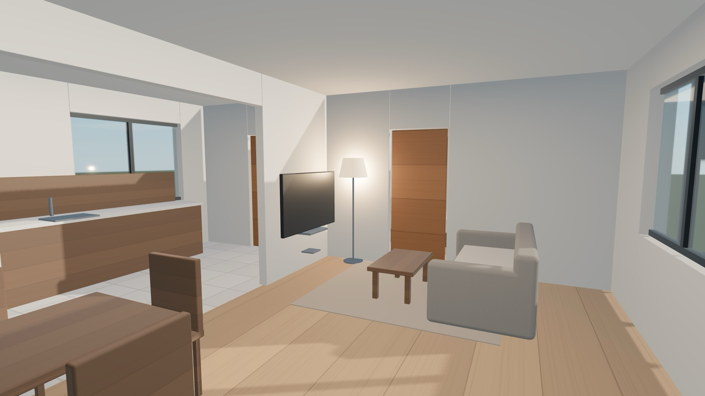
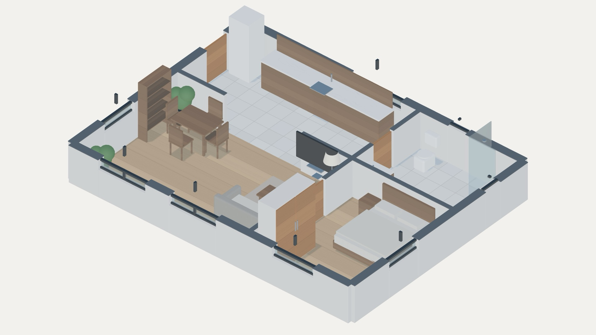
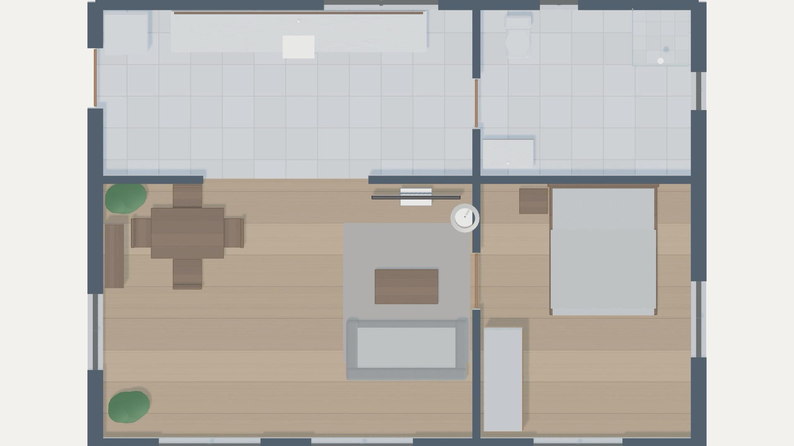

# scene-forge

**An agent skill that turns a brief, a sketch or a photo into a real 3D scene — no Blender, no GPU, no GUI.**

A metric JSON spec drives a live Three.js scene; headless Chrome captures it as 4K stills and exports GLB. Floor plans, dollhouse/axonometric views, interiors, image-to-3D, real-estate visuals and an interactive web tour — every result reproducible by editing the spec.

**[Install in Claude Code](#install-in-claude-code)** · [Quickstart](#quickstart) · [Modes](#four-modes) · [Spec](#spec-in-30-seconds)





## Install in Claude Code

```bash
git clone https://github.com/<your-user>/scene-forge.git ~/.claude/skills/scene-forge
cd ~/.claude/skills/scene-forge && npm install
```

That is the whole installation: the repository root **is** the skill (`SKILL.md`), so Claude Code discovers it at `~/.claude/skills/scene-forge/SKILL.md` and triggers it on 3D requests. For a single project, clone into `.claude/skills/scene-forge` instead.

```bash
python3 ~/.claude/skills/scene-forge/scripts/doctor.py   # {"ok": true, ...}
```

Requirements: **Node.js 18+** and **Chrome / Chromium / Edge** (already installed on most machines). `npm install` pulls only `puppeteer-core`, which drives your existing Chrome — no 300 MB browser download, no native build.

Then ask Claude Code things like:

- “Plan 3D d'un appartement de 65 m², 2 chambres, style scandinave, rendu 4K.”
- “Reconstitue cette cuisine en 3D depuis cette photo, puis sors un GLB.”
- “Transforme ce canapé en modèle 3D et intègre-le dans mon salon.”
- “Donne-moi une visite 3D à intégrer dans mon site.”

A short French block follows at the end of this file.

## Quickstart

```bash
cd ~/.claude/skills/scene-forge
mkdir -p out && cp examples/apartment.json out/plan.json

# preview (2–5 s)
node scripts/render.mjs --root out --spec plan.json --camera hero --size 1280x720 --out out/hero.png

# 4K
node scripts/render.mjs --root out --spec plan.json --camera hero --size 3840x2160 --out out/hero_4k.png

# plan + dollhouse axo
node scripts/render.mjs --root out --spec plan.json --camera plan --look plan --cut 1.2 --size 3840x2160 --out out/plan_4k.png
node scripts/render.mjs --root out --spec plan.json --camera axo  --look plan --cut 1.2 --size 3840x2160 --out out/axo_4k.png

# GLB
node scripts/export_glb.mjs --root out --spec plan.json --out out/model.glb

# interactive tour
python3 -m http.server 8000 --directory out
# → http://localhost:8000/viewer.html
```

`render.mjs` copies `viewer.html` and `scene-core.js` into `out/`, starts a static server and a headless Chrome, waits for `window.__sceneReady`, then screenshots. It prints JSON (`ok`, `out`, `width`, `height`, `seconds`).

## Four modes

| Mode | Input | Output |
|---|---|---|
| **A — Brief → plan** | Text programme, dimensions | `plan.json`, hero/plan/axo stills, 4K, GLB, tour |
| **B — Photo → 3D** | One photo or sketch | Reconstructed scene + camera matched to the photo |
| **C — Image → mesh** | One image + Tripo/Meshy key | Generative GLB, standalone or composed in a scene |
| **D — Web tour** | Any of the above | Orbit + first-person walk + hotspots, embeddable |

Details, golden rules and commands live in [SKILL.md](SKILL.md); the agent loads it automatically.

## What is inside

| Path | Role |
|---|---|
| `SKILL.md` | Agent instructions: modes, rules, commands, troubleshooting |
| `assets/scene-core.js` | Spec → Three.js world: walls/openings, rooms, 21 furniture builders, procedural textures, sun/sky, cameras |
| `assets/viewer.html` | Viewer: cameras, looks, orbit, WASD walk, hotspots, 4K snapshot, GLB download |
| `scripts/render.mjs` | Headless-Chrome stills |
| `scripts/export_glb.mjs` | GLB export from the live scene |
| `scripts/img2mesh.py` | Tripo / Meshy image-to-3D (no dependencies) |
| `scripts/camera_from_vps.py` | Focal + orientation from two vanishing points |
| `scripts/doctor.py` | Environment check |
| `references/` | Spec schema, look development, image-to-3D, viewer |
| `examples/apartment.json` | 9.5 × 7 m flat: 4 rooms, 7 walls, 21 pieces, 4 cameras, hotspots |

## Spec in 30 seconds

```json
{
  "name": "studio",
  "levels": [{ "elevation": 0, "height": 2.7 }],
  "environment": { "sun_elevation": 26, "sun_rotation": 35, "sun_strength": 4.4, "env_intensity": 0.24 },
  "rooms": [{ "name": "Séjour", "polygon": [[0,0],[6,0],[6,4.2],[0,4.2]], "floor": "oak" }],
  "walls": [{ "from": [0,0], "to": [6,0], "thickness": 0.24,
              "openings": [{ "type": "window", "offset": 2.0, "width": 1.8, "sill": 0.9, "height": 1.4 }] }],
  "furniture": [{ "type": "sofa", "pos": [4.9,1.5], "rot": 0, "w": 1.9 }],
  "cameras": [{ "name": "hero", "pos": [0.6,1.2,1.62], "target": [5.25,3.35,1.1], "lens": 22 }]
}
```

Metres, X east, Y north, Z up. Full schema: [references/plan-spec.md](references/plan-spec.md).

## Guarantees and limits

- **Deterministic.** Same spec + same Chrome → same image. No seeds to chase, no cloud render queue.
- **4K in seconds.** ~5 s for a 3840×2160 still on an M1 laptop (software WebGL / SwiftShader included).
- **Honest reconstruction.** Mode B is a measured rebuild of the photo, not photogrammetry. Hidden geometry, exact materials and dimensions behind the visible plane are not recoverable — the agent states this.
- **GLB textures are embedded** (procedural canvas textures baked at export), so GLB files are a few MB. Use `--cut` for a lighter dollhouse.
- **Desktop Chrome required for rendering.** Viewing works in any modern browser.
- No telemetry, no network calls at render time (three.js is loaded from jsDelivr once per page; vendor it for offline use).

## French

**scene-forge** transforme un brief, un croquis ou une photo en vraie scène 3D, sans Blender : plans cotés en mètres, vues dollhouse et axonométriques, rendus 4K, export GLB et visite web interactive (orbite, marche en première personne, hotspots).

Installation dans Claude Code :

```bash
git clone https://github.com/<your-user>/scene-forge.git ~/.claude/skills/scene-forge
cd ~/.claude/skills/scene-forge && npm install
```

Il suffit ensuite de demander « plan 3D de mon appart », « reconstitue cette pièce depuis la photo » ou « rends-moi ça en 4K ». Prérequis : Node.js 18+ et Chrome.

## License

MIT © LikSoft — see [LICENSE](LICENSE).
